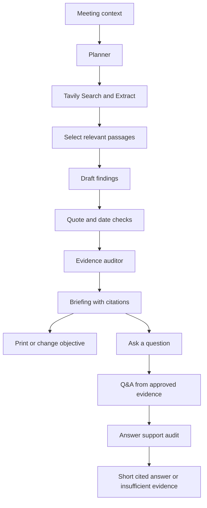

# Tehqiq workflow

The Python orchestrator owns this sequence, limits, and SQLite job state. Every model role calls Bifrost, which routes to configured OpenRouter free models. Tavily supplies source text. Roles exchange structured JSON through the application.

Recent findings use the 30 days before the meeting, capped at the current time. The planner can request background history up to 180 days, shown with a separate label. Search scope is bounded to four topic searches and one optional background search. Source selection and extraction remain capped at five pages.

The support audit can reject a claim. The diagram's briefing step may therefore contain fewer than three findings or no approved findings. Model or extraction failures produce an explicit error. Q&A searches no new pages and can decline to answer.

Evidence matching establishes a relationship between a claim and retrieved text. It does not establish that the publisher is correct or that two articles independently corroborate an event.
